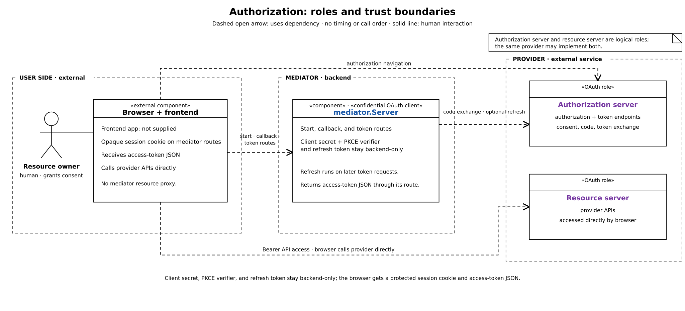
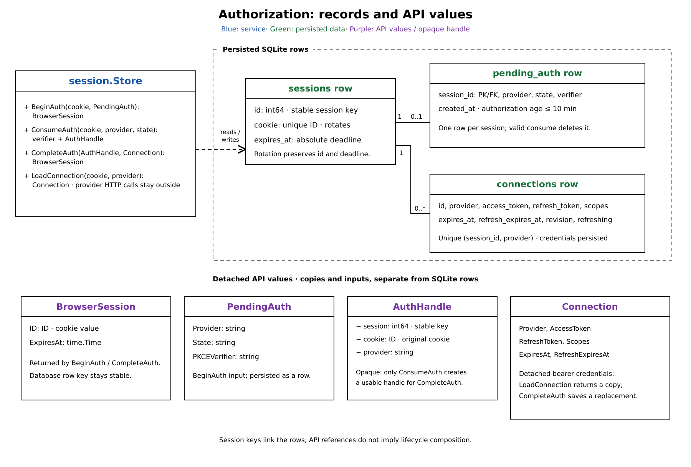
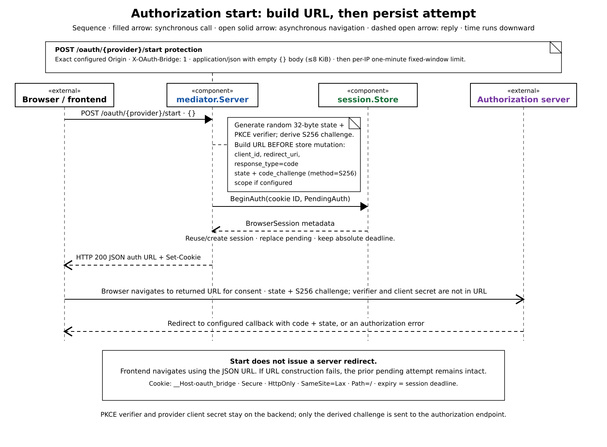
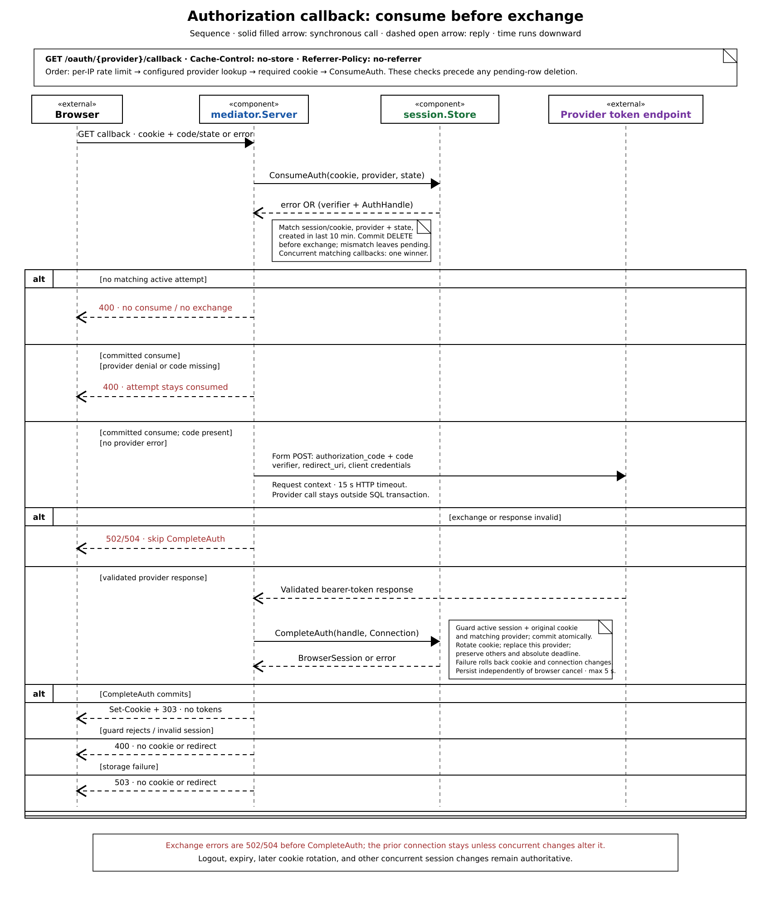
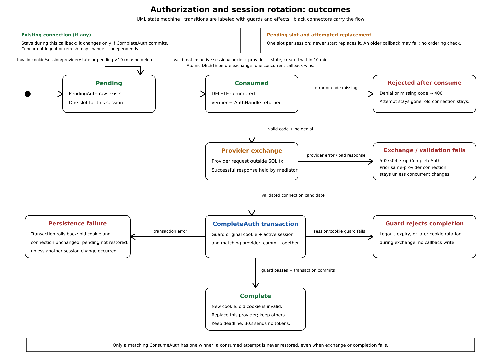

# Authorization and local session rotation

The browser starts authorization, visits the provider, and returns through a one-use callback. The Go mediator exchanges the code and stores provider credentials in SQLite. It rotates the local session cookie after that connection commits. This flow grants access; it does not verify a user's identity or implement OpenID Connect (OIDC).

HTTP examples use HTTP/1.1 header syntax for readability. The browser and provider may negotiate another HTTP version.



## Roles and the boundary

| Role | Responsibility in this flow |
| --- | --- |
| Resource owner | The person who authorizes access. The provider handles authentication and consent; the mediator does not receive the person's authentication credentials. |
| User-agent | The browser. It navigates to the provider and carries the authorization response back to the mediator. It transports protocol data but is not an OAuth role. |
| Client | The Go mediator backend, configured as a confidential client. It keeps the client secret and PKCE verifier on the server. |
| Authorization server (AS) | The provider's authorization and token endpoints. The AS authenticates the resource owner, obtains consent, issues a code, and exchanges that code for tokens. |
| Resource server (RS) | The provider API that accepts the access token. The AS and RS may be separate services. |

RFC 10017 describes this architecture as a token-mediating backend. The backend is the confidential OAuth client: it exchanges the code, stores credentials, and redirects to a fixed frontend completion URL. The frontend requests an access token from the mediator, then calls provider APIs with `Authorization: Bearer …`; the mediator has no resource-proxy route. This sends access tokens to frontend JavaScript, where malicious script can steal a token or ask the mediator for another one. `HttpOnly` blocks script from reading the cookie value, while authorized script can still use the token endpoint. Anyone holding a bearer token can use it within the provider's grant, so the frontend must protect tokens and use TLS for provider API requests. See [RFC 10017 §§6.2.1, 6.2.4.3.1](https://www.rfc-editor.org/rfc/rfc10017.html#section-6.2.4.3.1), [RFC 6749 §§1.1–1.3.1](https://www.rfc-editor.org/rfc/rfc6749.html#section-1.1), and [RFC 6750 §§1.2, 2.1](https://www.rfc-editor.org/rfc/rfc6750.html#section-2.1).

## Records and sensitive values



`session.Store` owns durable state and returns detached values rather than SQL identities or mutable store state. SQLite holds three authorization-related record types:

| Record | Key relationship | Authorization data |
| --- | --- | --- |
| `sessions` | One stable internal row per browser session; each cookie value is unique | Opaque cookie value and absolute `expires_at` deadline. The SQL row ID stays the same when the cookie rotates. |
| `pending_auth` | Zero or one row per session (`session_id` is the primary key) | Provider name, `state`, private verifier, and `created_at`. A new start replaces the row, even when it names another provider. |
| `connections` | Zero or more rows per session, with at most one per provider | Access token, optional refresh token and deadlines, provider-returned scope, row revision, and refresh marker. Reconnecting replaces that provider's row. |

The protocol values have distinct owners and purposes:

| Value | Who sees or uses it | Meaning here |
| --- | --- | --- |
| `client_id` | Public; sent to the AS in both requests | Identifies the provider registration. It does not authenticate the client. |
| `client_secret` | Backend configuration; sent in the token-request body | Client authentication for this provider compatibility profile. It is separate from PKCE. |
| `state` | Authorization URL and callback URL | Fresh, one-use local correlation value. The store matches it with the browser cookie and provider route. |
| PKCE `code_verifier` | Stored in `pending_auth`; sent only in the backend-to-AS token request | Per-attempt proof kept out of the browser. It is not the client secret. |
| PKCE `code_challenge` | Authorization URL | Public S256 transform of the verifier. A conforming AS binds it to the code and checks the verifier at exchange. |
| Authorization `code` | Returned through the browser callback | Short-lived, single-use grant enforced by the AS. Consuming the local pending attempt is a separate one-use check. |
| Access token | Stored by the backend, then returned to the browser | Provider-issued bearer credential for resource APIs. |
| Refresh token | Stored and used only by the backend | Optional provider credential for later access tokens. It is not the browser's session cookie; refresh behavior is outside this authorization trace. |
| Session cookie | Browser cookie jar and backend SQLite row; `HttpOnly` blocks script reads | Opaque local session credential, not an OAuth token. Successful connection completion replaces its value. |
| `AuthHandle` | Internal store return value | Detached capability binding a consumed attempt to its stable SQL session, original cookie, and provider. It is never sent to the browser or provider. |

The mediator generates `state` and the verifier independently. `generateRandomString(32)` uses 32 cryptographically random bytes and unpadded base64url, producing 43 characters; the cookie ID comes from a separate 32-byte draw. The S256 challenge is:

```text
BASE64URL(no padding)(SHA256(ASCII(code_verifier)))
```

The AS must retain the challenge with its code and reject a mismatching verifier for PKCE to protect the exchange. PKCE makes an intercepted code insufficient on its own; it does not replace client authentication or protect a compromised browser. RFC 9700 requires PKCE for public clients and recommends it for confidential clients; this backend uses it as well. The code sends S256, but does not discover or independently verify provider support. It also does not validate `auth_url` for HTTPS. Configure an HTTPS authorization endpoint, as [RFC 6749 §3.1](https://www.rfc-editor.org/rfc/rfc6749.html#section-3.1) requires. See [RFC 7636 §§4.1–4.6](https://www.rfc-editor.org/rfc/rfc7636.html#section-4.1) and [RFC 9700 §§2.1, 2.1.1](https://www.rfc-editor.org/rfc/rfc9700.html#section-2.1.1).

## Start and consent



### Browser request

The browser sends `POST /oauth/{provider}/start` with credentials included. For a cross-origin frontend request, CORS allows only the configured exact `Origin` and permits credentials. The frontend and mediator must also be same-site for the `SameSite=Lax` cookie to accompany this cross-origin POST. No cookie is needed on the first start.

```http
POST /oauth/alpha/start HTTP/1.1
Origin: https://frontend.example
Content-Type: application/json
X-OAuth-Bridge: 1

{}
```

This first-start example has no `Cookie` header. A reused session sends `Cookie: __Host-oauth_bridge=<existing-cookie>`. An accepted request returns `200` with an `authorization_url` JSON field and `Set-Cookie`. The response names the configured CORS origin, allows credentials, exposes `Retry-After`, varies on `Origin`, and sets `Cache-Control: no-store`. The mediator builds the URL from provider configuration plus this attempt's state and challenge; the browser cannot supply an authorization URL. OAuth does not standardize this local POST-and-JSON start endpoint. RFC 10017 depicts a browser navigation to the backend followed by a redirect to the AS; this implementation returns the URL for the frontend to navigate to ([RFC 10017 §6.2.1](https://www.rfc-editor.org/rfc/rfc10017.html#section-6.2.1)).

| Check, in order | Accepted input or effect |
| --- | --- |
| Origin middleware | `Origin` must exactly equal configured `frontend_origin_url`; otherwise JSON `403 forbidden`. Success uses that CORS origin, `Access-Control-Allow-Credentials: true`, `Access-Control-Expose-Headers: Retry-After`, and `Vary: Origin`. |
| Browser POST validation | Requires `X-OAuth-Bridge: 1`, a `Content-Type` parsed as `application/json` (parameters such as `charset` are allowed), and a body no larger than 8 KiB that is exactly `{}` apart from whitespace. A missing or wrong bridge header gives `403`; a bad media type or body gives `400`. Null, other shapes, fields, a second JSON value, or trailing junk are rejected. |
| Preflight (`OPTIONS`) | Requires the exact allowed origin and requested method `POST`; success is `204` and advertises only `POST` plus `Content-Type, X-OAuth-Bridge`. The requested-header list is not checked against a separate allowlist. |
| Shared IP limit | Start and token POSTs that pass origin and body validation, plus callback requests, share a per-IP fixed one-minute window. Rejection returns JSON `429 rate_limited` with `Retry-After`. Preflight is not rate-limited. |
| Provider lookup | If the request passes the IP limit, an unknown provider on start returns plain-text `404`; the token route instead returns JSON `unknown_provider`. |

`X-OAuth-Bridge: 1` is a static header, not a secret or random token. Its custom-header status forces cross-origin browser scripts through preflight; exact-origin CORS and the server's `Origin` check then restrict browser POSTs to the configured frontend. Start and token use these protections. The callback is a separate navigation GET; its one-use state is bound to the session and provider route ([RFC 10017 §§6.2.3.3, 6.1.3.3.2](https://www.rfc-editor.org/rfc/rfc10017.html#section-6.1.3.3.2)).

The limiter uses the direct peer IP, or one `X-Forwarded-For` value when the peer is loopback. This supports the intended local-Caddy setup. `rate_limit_per_minute` and `rate_limit_max_ips` configure a process-local fixed one-minute window, not per-user or provider-call quotas. If the IP table is full, new IPs are rejected rather than evicting existing counters. `Retry-After` rounds the remaining wait up to seconds. Restarting clears counters. The window permits a boundary burst, and users behind one IP share a quota. See [`allowBrowserOrigin` and POST validation](../../internal/mediator/helpers.go#L22-L85), [route wiring](../../internal/mediator/server.go#L109-L141), and [IP limiting](../../internal/mediator/rate_limit.go#L24-L88).

### Authorization request

The handler looks up the provider, generates state and PKCE material, then builds the authorization URL before calling `BeginAuth`. It preserves unrelated query parameters from `auth_url`; `url.Values.Set` replaces duplicate protocol parameters with one value. A malformed URL or query returns a sanitized configuration error before `BeginAuth` can replace an existing pending attempt.

The authorization request contains:

| Parameter | Value sent |
| --- | --- |
| `client_id` | Configured public provider client ID |
| `redirect_uri` | Configured callback URI |
| `response_type` | `code` |
| `state` | Fresh 32-byte random value, base64url without padding |
| `code_challenge` | S256 value derived from this attempt's verifier |
| `code_challenge_method` | `S256` |
| `scope` | Configured scopes joined by one space; omitted when none are configured |

The query is equivalent to `client_id=CLIENT_ID&code_challenge=CHALLENGE&code_challenge_method=S256&redirect_uri=https%3A%2F%2Fmediator.example%2Foauth%2Falpha%2Fcallback&response_type=code&scope=read%3Aprofile+email&state=STATE`; an unrelated parameter such as `tenant=TENANT` remains. Values are symbolic; the state and challenge are freshly generated. Scope requests permission but does not guarantee what the AS grants. The mediator stores the returned `scope` when present rather than assuming it received all requested scopes. See [RFC 6749 §§3.3, 4.1.1](https://www.rfc-editor.org/rfc/rfc6749.html#section-4.1.1).

`BeginAuth` uses one SQLite transaction. It reuses an active session identified by the supplied cookie, preserving its absolute expiry; otherwise it creates a session if capacity permits. It upserts that session's single pending row with the provider, state, verifier, and current creation time. An active session can start when the store is full, but a new session cannot. On success, the route returns `200` JSON with `authorization_url` and a session cookie.

The cookie is `__Host-oauth_bridge`. New sessions get a fresh opaque ID; reused sessions keep their current ID. The cookie has `Secure`, `HttpOnly`, `SameSite=Lax`, `Path=/`, no `Domain`, and `Expires` at the stored session deadline (an HTTP date has one-second precision). It has no `Max-Age`. The `__Host-` prefix requires `Secure`, `/`, and no domain. Neither another start nor callback rotation extends the session deadline.

RFC 10017 applies its BFF cookie guidance to token-mediating backends. It requires `Secure` and `HttpOnly`, and recommends `SameSite=Strict`, `Path=/`, no `Domain`, and a prefix for an HTTP-set cookie, such as `__Host-Http-`. This code sets the required flags, root path, and no `Domain`; it uses `SameSite=Lax` and the `__Host-` prefix. Lax permits the provider's cross-site top-level GET callback; Strict is less permissive. Browser POST guards remain active, though these cookie settings differ from some RFC 10017 recommendations ([RFC 10017 §§6.2.3.2, 6.1.3.2](https://www.rfc-editor.org/rfc/rfc10017.html#section-6.1.3.2)).

The browser navigates to the provider URL. The provider authenticates the person and asks for consent; the client never receives the provider password. On approval, the AS returns a code and state to the configured callback. The client sends the same configured `redirect_uri` in both authorization and token requests. The AS must match it to the client registration. The AS must make authorization codes short-lived; RFC 6749 recommends a maximum lifetime of ten minutes. That AS-side code lifetime is separate from the local ten-minute pending-attempt check. See [RFC 6749 §§3.1.2, 4.1.2](https://www.rfc-editor.org/rfc/rfc6749.html#section-4.1.2).

## Callback, exchange, and completion



### Callback and code exchange

The provider sends the browser to `GET /oauth/{provider}/callback?code=…&state=…` (or with OAuth error parameters). The browser attaches its mediator-host cookie; the provider does not supply or read that cookie. This is a navigation GET, not a browser POST, so the route does not require `Origin`, `X-OAuth-Bridge`, CORS, or a JSON body. `Cache-Control: no-store` and `Referrer-Policy: no-referrer` apply even when callback middleware rejects the request.

```http
GET /oauth/alpha/callback?code=AS_CODE&state=STATE HTTP/1.1
Host: mediator.example
Cookie: __Host-oauth_bridge=<session-cookie>
```

For a denial, the AS returns an OAuth `error`; because the request includes `state`, it must return the same value. The handler does not reflect `error_description` to the browser. Local state is bound to the cookie and provider attempt, then consumed once. PKCE separately binds code redemption to the backend-held verifier. These checks protect different parts of the flow: callback state validation and browser POST protections address request forgery, while PKCE protects code redemption. See [RFC 6749 §§4.1.1, 4.1.2.1, 10.12](https://www.rfc-editor.org/rfc/rfc6749.html#section-10.12) and [RFC 9700 §2.1](https://www.rfc-editor.org/rfc/rfc9700.html#section-2.1).

After provider lookup and the cookie check, the handler calls `ConsumeAuth`. One transaction matches the active session cookie, provider route, state, and `created_at >= now − 10 minutes`. It deletes and commits the pending row before returning the verifier and `AuthHandle`. Invalid, expired, wrong-provider, wrong-session, replayed, or storage-failed attempts stop before contacting the provider; concurrent matching callbacks have one winner. The handler checks for an AS `error` or missing code only after consume succeeds, so either outcome spends the local attempt without an exchange. The AS's one-time code check is separate.

The backend sends this token request with the callback request context, a 15-second HTTP client timeout, and redirects disabled:

```http
POST /token HTTP/1.1
Host: auth.example
Content-Type: application/x-www-form-urlencoded
Accept: application/json

client_id=CLIENT_ID&client_secret=BACKEND_SECRET&code=AS_CODE&code_verifier=PRIVATE_VERIFIER&grant_type=authorization_code&redirect_uri=https%3A%2F%2Fmediator.example%2Foauth%2Falpha%2Fcallback
```

The form body contains exactly `grant_type=authorization_code`, `code`, the same `redirect_uri`, `code_verifier`, `client_id`, and `client_secret`; the displayed values are examples. For the supported-provider profile, the client sends its secret in the form body, never with HTTP Basic or in the URI. RFC 6749 permits body credentials but discourages this method and limits its use to clients unable to use HTTP Basic. The AS must protect a token endpoint that uses password authentication with TLS. See [RFC 6749 §§2.3.1, 4.1.3](https://www.rfc-editor.org/rfc/rfc6749.html#section-2.3.1).

The supported provider profile is S256 code flow, form-encoded token requests with body credentials, and JSON bearer-token responses ([documented limit](../decisions.md)). The AS must enforce PKCE; the client sends S256 but does not discover or independently verify provider support. A token response must have HTTP `200` and a JSON body no larger than 64 KiB. The client sends `Accept: application/json` but does not check response `Content-Type`; redirects are not followed.

| Token response field | Handling |
| --- | --- |
| `access_token` | Required and must not be the empty string. Whitespace is not trimmed. |
| `token_type` | Required by the callback; when present, the parser accepts only `Bearer`, case-insensitively. |
| `expires_in` | Optional; if present it must be positive and fit in a Go duration, then becomes an absolute deadline. |
| `refresh_token` | Optional; if present it must not be empty and is stored only in SQLite. |
| `refresh_token_expires_in` | Optional; if present it must be positive and fit in a Go duration. It becomes a deadline only when a refresh token is present. |
| `scope` | Optional provider-returned scope, stored as received. If absent, the app does not infer the requested scopes. |
| OAuth `error` | Any parsed provider error fails the exchange. Provider descriptions and response bodies are not returned to the browser. |

An illustrative success body is `{"access_token":"<provider-access-token>","token_type":"Bearer","expires_in":3600,"refresh_token":"<optional-provider-refresh-token>","scope":"read:profile"}`. Optional fields may be absent, and the response `Content-Type` is not checked.

The parser accepts only `Bearer` when `token_type` is present; the callback separately requires that field, while refresh responses can omit it. It ignores response `Content-Type` and treats whitespace-only token strings as nonempty. RFC 6749 defines token-response fields and permits an omitted `expires_in` or refresh token. It requires the AS to return `scope` when the granted scope differs from the request. See [RFC 6749 §§4.1.4, 5.1](https://www.rfc-editor.org/rfc/rfc6749.html#section-5.1).

### Persist and rotate

After a valid provider response, the handler builds a detached connection and calls `CompleteAuth` with a five-second context that survives browser-request cancellation. One transaction checks that the handle's provider matches and that the same stable session row still has the original cookie and remains active. It then rotates the cookie, replaces that provider's connection, and commits. A failed transaction rolls back both changes, preserving connections for other providers. Logout, expiry, or an earlier cookie rotation makes the handle stale.

After commit, the mediator sets the new cookie and returns `303 See Other` to the configured static frontend completion URL. The redirect contains neither code nor tokens. The cookie keeps its original deadline and protections. Delaying rotation until the connection commits reduces session-fixation exposure: the old cookie stops working, while the SQL session identity stays stable. This local session rotation is independent of OAuth and provider refresh-token rotation.

The completion response looks like this (header order and cookie date formatting are illustrative):

```http
HTTP/1.1 303 See Other
Set-Cookie: __Host-oauth_bridge=<rotated-opaque-id>; Path=/; Expires=<original-session-deadline>; Secure; HttpOnly; SameSite=Lax
Location: https://frontend.example/oauth/complete
Cache-Control: no-store
Referrer-Policy: no-referrer
```

The browser then calls `POST /oauth/{provider}/token`, protected by the same exact-Origin, bridge-header, and empty-JSON checks as start. On success, the mediator returns `access_token`, `token_type: Bearer`, and, when known, remaining `expires_in` and stored `scope`. It does not return the refresh token:

```http
HTTP/1.1 200 OK
Content-Type: application/json
Cache-Control: no-store

{"access_token":"<provider-access-token>","token_type":"Bearer","expires_in":3599,"scope":"read:profile"}
```

The browser presents that bearer token directly to the provider API, not through the mediator. See [`providerToken`](../../internal/mediator/server.go#L310-L367) and [RFC 6750 §2.1](https://www.rfc-editor.org/rfc/rfc6750.html#section-2.1).

## Outcomes



| Stage and condition (after earlier middleware unless noted) | HTTP result | State and next action |
| --- | --- | --- |
| Provider preflight: wrong origin/method or unknown provider | `403` / `404`, JSON | A rejected preflight has no allow-method/header response. An accepted one is `204` with no body. |
| Start: origin, bridge-header, content-type, or body guard fails | `403` or `400`, JSON | The handler and store are not reached. |
| Start: unknown provider after passing the IP limit | `404`, plain-text body | No session or pending-attempt change. |
| Start: malformed authorization URL | `500 provider_configuration_error`, JSON | URL construction precedes `BeginAuth`, so an existing pending attempt remains unchanged. |
| Start: session capacity is full for a new session | `429 session_limit_reached`, JSON | No new session or cookie. An active session can still be reused. |
| Rate limit: window or IP table is full | `429 rate_limited`, JSON plus `Retry-After` | Start, callback, and token share the window. Existing IP counters are not evicted to admit a new IP. |
| Rate limit: peer/IP cannot be parsed | `400 invalid_request`, JSON | Middleware stops before the route handler. |
| Start: random state or PKCE generation fails | `500`, generic body | No `BeginAuth` write occurs. |
| Start: storage failure | `503 storage_unavailable`, JSON | No successful URL or cookie is returned. |
| Start: accepted | `200`, JSON `authorization_url` plus cookie | The one pending attempt is committed before the browser navigates away. |
| Callback: unknown provider or missing cookie | `404` or `400`, plain-text body | No provider exchange. |
| Callback: invalid, expired, or replayed state; invalid local session | `400 invalid auth state`, plain text | Validation fails before the pending attempt is consumed; no exchange occurs. |
| Callback: storage failure during consume | `503 storage_unavailable`, JSON | No verifier is released and no exchange occurs. A rolled-back consume leaves the pending row intact. |
| Callback: valid state, but provider denial or missing code | `400`, plain text | The local attempt was already consumed; this callback cannot be retried. |
| Callback: provider timeout | `504`, generic text body | The attempt stays consumed; the client does not retry the code. |
| Callback: upstream, JSON, or token validation failure | `502`, generic text body | Provider details, tokens, and redirect are not exposed. |
| Callback: completion storage failure | `503 storage_unavailable`, JSON | The attempt stays consumed. Transaction rollback leaves the old cookie/connection unchanged unless another operation changed them. |
| Callback: session logged out, expired, or rotated during exchange | `400 invalid session`, plain text | Completion is rejected; it cannot restore the session. |
| Callback: commit succeeds | `303` to configured completion URL plus rotated cookie | The connection and cookie change atomically; other provider connections and the absolute deadline remain. |
| Token route: provider unknown | `404 unknown_provider`, JSON | No session lookup. |
| Token route: storage failure | `503 storage_unavailable`, JSON | No token or cookie is returned. |
| Token route: no active session/connection, or an expired token that cannot be refreshed | `401 reauthorization_required`, JSON | The browser must authorize again; no cookie is issued. |
| Token route: provider timeout or other provider error | `504 provider_timeout` or `502 provider_error`, JSON | Provider details are not returned. |
| Token route: accepted | `200`, JSON | Returns the access token and only the optional known expiry/scope; no refresh token or cookie. |

Unknown-provider bodies differ by route: start and callback return plain text; the token route returns JSON. Callback errors, denial, exchange failure, and storage failure do not redirect to completion or issue a replacement cookie. If `CompleteAuth` rolls back, the store could retry with the same in-memory handle while the original session/cookie remain active; the HTTP handler does not retry the exchange or completion. A fresh callback cannot reuse the consumed attempt.

## Concurrency, cancellation, restart, and operating limits

| Event | Observed consequence |
| --- | --- |
| Two callbacks consume one pending attempt | `ConsumeAuth` is transactional; only one receives the verifier and handle. |
| A new start arrives before an earlier attempt is consumed | `BeginAuth` replaces the one pending row, so the old state no longer matches. |
| A new start arrives after an older callback consumed its attempt | The older exchange runs outside the SQL transaction without a generation or latest-start check. It can finish while its original cookie remains current, then rotate the cookie and make the newer callback fail. |
| Logout, expiry, or another rotation occurs during exchange | `CompleteAuth` checks the stable session and original cookie, then rejects a stale handle. Logout deletes local session state; it does not revoke provider-issued access tokens. |
| The browser request is canceled during exchange | The provider request uses that request's context and a 15-second client timeout. If the response succeeds, final persistence uses an independent five-second context and can outlive the cancellation. |
| The server commits but the browser disconnects before receiving `Set-Cookie` | The database commit and response delivery cannot be atomic. The old cookie is invalid after commit, even if the browser never received the new one. |
| The process restarts with a committed pending attempt | SQLite preserves it. It remains usable only while the session is active and the local ten-minute age check passes. |
| The process stops after consume or after exchange but before completion | The attempt is already deleted. The code does not recover or retry the exchanged code or in-memory tokens; start authorization again. If completion rolled back, the previous connection remains. |

Cookie rotation changes the unique cookie value while preserving the stable `sessions.id`. Other provider connections stay attached to that row. An in-flight refresh for another provider can still commit against the stable session/provider identity after authorization rotates the cookie. A request that reloads with only the old cookie is rejected. Reconnecting the same provider deletes and inserts its connection row, giving it a new identity so stale conditional writes cannot overwrite it. These details show how authorization interacts with refresh.

The store owns one SQLite file exclusively in one process. It creates the database with mode `0600` and requests mode `0700` for new parent directories; it does not encrypt the database at the application layer. The database and its backups contain sensitive cookies, pending verifiers, access tokens, refresh tokens, and scopes. Committed sessions survive a restart; startup recovery does not restore a consumed attempt. Cleanup runs every ten minutes, so an expired session may occupy capacity until cleanup. Session lifetime is absolute (one second through 400 days) and does not extend on start or callback rotation. A full store rejects new sessions without evicting existing ones; logout frees a slot immediately. See [`session.Open` and schema/recovery](../../internal/session/store.go#L88-L232), [`BeginAuth`, `ConsumeAuth`, and `CompleteAuth`](../../internal/session/store.go#L237-L348), [exclusive SQLite ownership](../../internal/session/sqlite.go#L14-L30), and the intentional [limits](../decisions.md).

Providers must support authorization-code flow with S256, form-encoded token exchange, client credentials in the body, and JSON bearer-token responses. Configuration does not fully validate `auth_url` or `redirect_url`, check registered redirect-URI equality, or require different callback URIs for different providers. `token_url` must use HTTPS, except for loopback or `localhost` HTTP. The completion URL is static and checked only for nonempty text; deployment must also set the frontend origin correctly.

The callback binds state to the provider route, but does not validate an authorization-response `iss` value. Configuration also does not require distinct callback URIs. RFC 9700 requires a mix-up defense when a client interacts with multiple authorization servers, using issuer identification or, where appropriate, distinct redirect URIs ([RFC 9700 §§2.1, 4.4.2](https://www.rfc-editor.org/rfc/rfc9700.html#section-4.4.2)). Whether a deployment meets the conditions for a mix-up attack depends on its actual providers and registrations; the code does not validate those deployment choices. The repository includes no frontend or Caddy configuration, so same-site cookie behavior, credentialed frontend requests, TLS termination, and trusted-proxy setup depend on deployment.

## Source, test, and protocol evidence

Implementation anchors: [`providerOAuthStart` and `providerOAuthCallback`](../../internal/mediator/server.go#L173-L308), [authorization URL and token request](../../internal/mediator/oauth.go#L39-L83), [random values and cookie attributes](../../internal/mediator/helpers.go#L88-L135), [configuration validation](../../internal/mediator/config.go#L68-L124), and [runtime cleanup/store ownership](../../main.go#L26-L68).

Focused regression evidence: [`TestOAuthFlow`](../../internal/mediator/oauth_flow_test.go#L24-L235), [`TestOAuthStart_InvalidAuthorizationURLDoesNotReplacePendingAuth`](../../internal/mediator/oauth_flow_test.go#L237-L263), [`TestOAuthCallback_RotationPreservesSession`](../../internal/mediator/oauth_flow_test.go#L298-L345), [`TestOAuthCallback_ProviderFailures`](../../internal/mediator/oauth_flow_test.go#L349-L424), [`TestAuthorizationTransactions`](../../internal/session/store_test.go#L67-L119), [`TestCompletionRejectsInactiveSession`](../../internal/session/store_test.go#L166-L190), [`TestConsumeConcurrent`](../../internal/session/store_test.go#L398-L417), [`TestConsumeRollback`](../../internal/session/store_test.go#L665-L676), [`TestSessionLogout_InFlightOAuth`](../../internal/mediator/server_test.go#L98-L155), [`TestRefreshAcrossCookieRotation`](../../internal/mediator/storage_test.go#L225-L275), [`TestFinalWriteFailureRecovery`](../../internal/mediator/storage_test.go#L54-L111), and browser-guard tests [`TestValidateBrowserPost_Validation` and `TestProviderPreflight`](../../internal/mediator/server_test.go#L314-L441).

Protocol references: [OAuth 2.0, RFC 6749](https://www.rfc-editor.org/rfc/rfc6749.html) §§1.1–1.3.1, 2.1–2.3.1, 3.1.2, 3.3, 4.1.1–4.1.4, 5.1, 10.12; [PKCE, RFC 7636](https://www.rfc-editor.org/rfc/rfc7636.html) §§4.1–4.6; [OAuth 2.0 Security BCP, RFC 9700](https://www.rfc-editor.org/rfc/rfc9700.html) §§2.1, 2.1.1, 4.4.2; [OAuth 2.0 for Browser-Based Applications, RFC 10017](https://www.rfc-editor.org/rfc/rfc10017.html) §§6.2.1, 6.2.3.1–6.2.3.3, 6.2.4.3.1, 6.1.3.2, 6.1.3.3.2; and [Bearer Token Usage, RFC 6750](https://www.rfc-editor.org/rfc/rfc6750.html) §§1.2, 2.1.

[Back to the architecture overview](overview.md#authorization-consume-before-exchanging).
