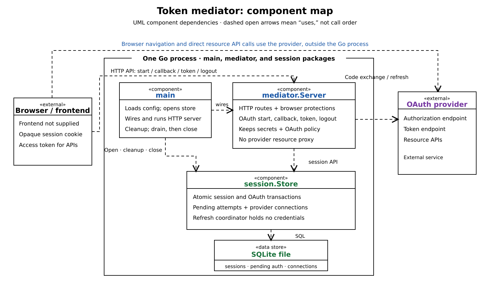
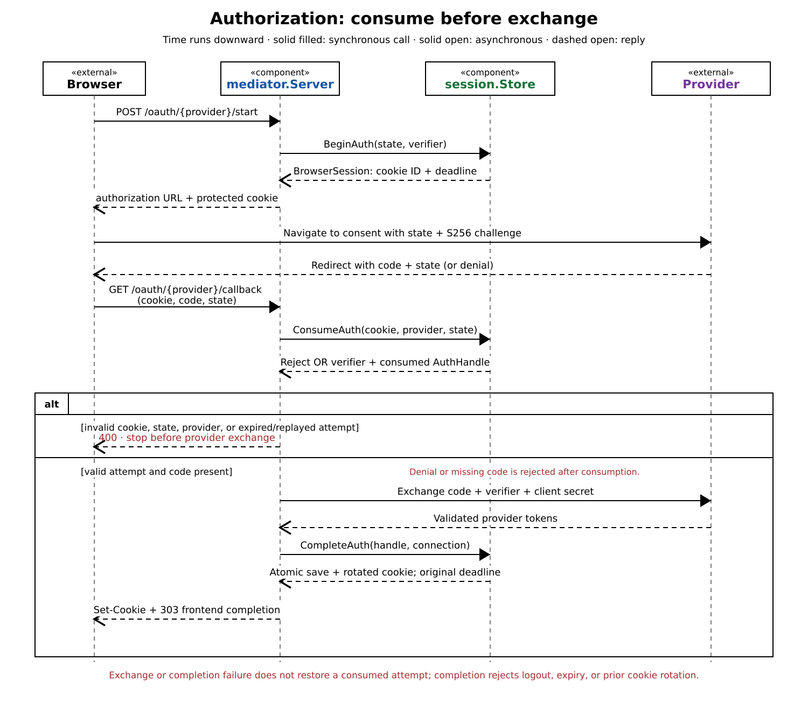
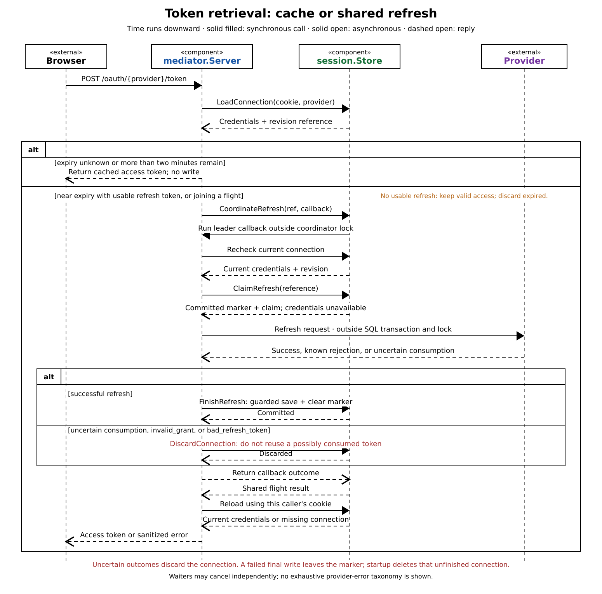

# Token mediator at a glance

This is one Go process with internal package boundaries, not a set of services. The component map shows ownership; the two sequence diagrams follow authorization and token retrieval.

`main` loads configuration, opens the concrete SQLite-backed `session.Store`, runs ten-minute cleanup, and starts `mediator.Server`. On shutdown the server drains and waits for handlers; `main` then stops cleanup and closes the store. The server owns browser HTTP protections and OAuth policy. The store owns session state, SQL transactions, and a credential-free refresh coordinator. See [`main.go`](../../main.go#L26-L68), [`mediator.Server`](../../internal/mediator/server.go#L20-L62), and [`session.Open`](../../internal/session/store.go#L118-L171).

At the intended boundary, the browser receives an opaque session cookie and access tokens, then calls provider resource APIs directly with the access token ([README](../../README.md#L7-L8)); the mediator has no resource proxy route ([registered routes](../../internal/mediator/server.go#L109-L120)). Client secrets, refresh tokens, and PKCE verifiers remain backend-side. The repository supplies neither a frontend nor Caddy configuration, so this is a logical view rather than a deployment diagram. The existing [architecture note](../architecture.md#runtime-and-setup) describes the assumed local-Caddy deployment.

## Authorization: consume before exchanging

The start route creates state and PKCE material, then `BeginAuth` saves the verifier and pending attempt before returning the authorization URL and cookie. On callback, `ConsumeAuth` validates and deletes the matching attempt atomically before any provider exchange. `CompleteAuth` then saves the connection and rotates the cookie in one transaction, preserving the session deadline and other providers. See [`providerOAuthStart` and `providerOAuthCallback`](../../internal/mediator/server.go#L173-L308) and the [store transactions](../../internal/session/store.go#L241-L348).

An invalid, expired, or replayed attempt stops before the provider. A valid attempt is already consumed if the user denied consent, the code is missing, exchange fails, or completion cannot be saved; it cannot be replayed. Completion also rejects a logged-out, expired, or already-rotated session. The known overlapping-attempt ordering limit is in [Decisions to skip](<../Decisions%20to%20skip.md>). The full [authorization explanation](../architecture.md#authorization) and [authorization breakdown](../architecture-breakdown.md#2-turn-authorization-into-a-connection) are the next zooms. Tests: [`TestOAuthFlow`](../../internal/mediator/oauth_flow_test.go#L24-L235) and [`TestAuthorizationTransactions`](../../internal/session/store_test.go#L67-L119).

## Token retrieval: share work, guard persistence

Unknown access-token expiry or more than two minutes remaining uses cached credentials without a write. Near expiry, the mediator coordinates one refresh per stable session/provider; concurrent callers share its result and may cancel their own wait. The leader rechecks current state and commits a refresh claim before contacting the provider. The leader request context controls the provider call; outcome persistence uses an independent five-second context even after cancellation. Provider HTTP runs outside SQL transactions and coordination locks. Successful credentials are saved only against the claimed revision; an uncertain provider outcome may have consumed a rotating refresh token, so that connection is discarded rather than reused. A known non-consuming rejection instead saves the original credentials to clear the claim marker, except `invalid_grant` and `bad_refresh_token`, which discard the connection; the sequence omits this outcome. See [`accessConnection`](../../internal/mediator/refresh.go#L17-L115), [`CoordinateRefresh`](../../internal/session/refresh.go#L19-L45), and the [guarded store writes](../../internal/session/store.go#L392-L435).

If final persistence fails, the committed marker keeps old credentials unavailable; startup removes unfinished connections and that provider needs authorization again. Logout removes local session state but does not revoke tokens already issued by a provider. The [token retrieval and refresh explanation](../architecture.md#token-retrieval-and-refresh) and [refresh breakdown](../architecture-breakdown.md#3-share-refresh-work-and-guard-its-result) are the next zooms. Tests: [`TestProviderToken_ConcurrentRefresh` and refresh failures](../../internal/mediator/refresh_test.go#L238-L390), plus [store recovery and refresh guards](../../internal/session/store_test.go#L194-L257).
