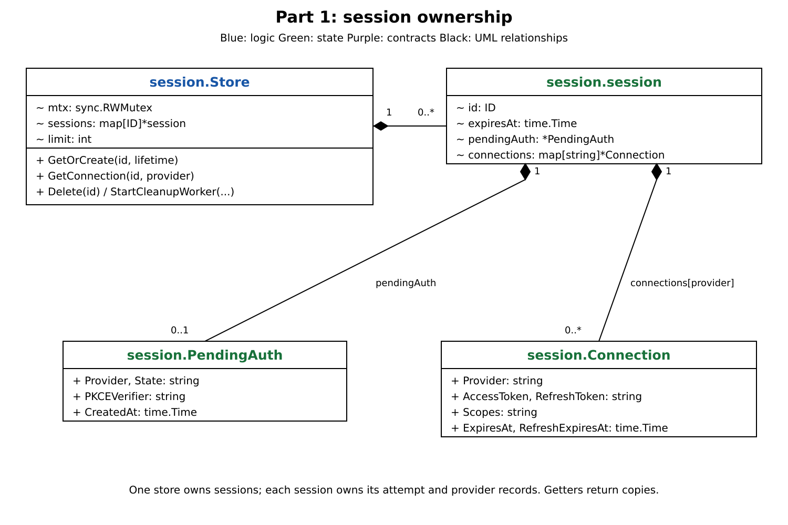
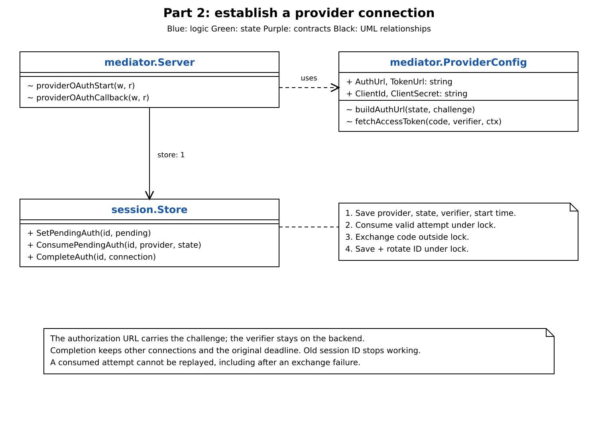
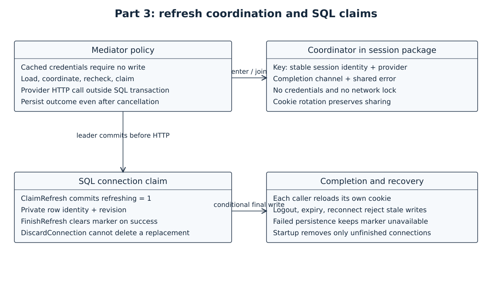

# Token mediator breakdown

Read the [architecture note](architecture.md) for setup, browser protections, failure behavior, and runtime details. These three steps reconstruct the SQL-first design.

## 1. Give session state one owner

`session.Store` owns one SQLite file, lifetime, and capacity. Sessions have a stable internal key, opaque browser cookie, and absolute deadline. Cascading pending authorization and connection rows belong to that session. One attempt exists per session and one connection per provider.

`BeginAuth` creates or reuses a session and replaces its pending attempt in one transaction. `LoadConnection` joins active session and provider state and returns a detached value. `Logout` cascades deletion; `CleanupExpired` removes expired records every ten minutes. Expired sessions reject access before cleanup but still occupy capacity.

## 2. Turn authorization into a connection

The mediator generates state and PKCE material before `BeginAuth`. The browser gets a provider URL with a challenge; the verifier stays in SQL.

`ConsumeAuth` validates cookie, provider, state, and attempt age, then deletes the attempt transactionally. It returns a verifier and opaque handle. The mediator exchanges the code outside a transaction. `CompleteAuth` uses that handle to save the matching provider and rotate the cookie atomically, preserving the deadline and other connections. Logout, expiry, or obsolete cookies reject completion.

## 3. Share refresh work and guard its result

The mediator owns refresh policy. Suitable cached credentials require no write. When refresh is needed, the coordinator shares one operation per stable session identity and provider using channels and errors; it holds no credentials.

The leader reloads state and commits `ClaimRefresh` before the provider call. The claim marks that row unavailable and carries its revision. `FinishRefresh` or `DiscardConnection` checks row identity, revision, and session activity before writing. Reconnect changes identity, while cookie rotation preserves the stable session key.

Known rejection retains credentials; uncertain consumption discards them. Outcomes persist through browser cancellation using a separate five-second context. Failed persistence leaves the marker in place, and startup deletes unfinished connections. Each caller reloads after shared completion and validates its own cookie.
