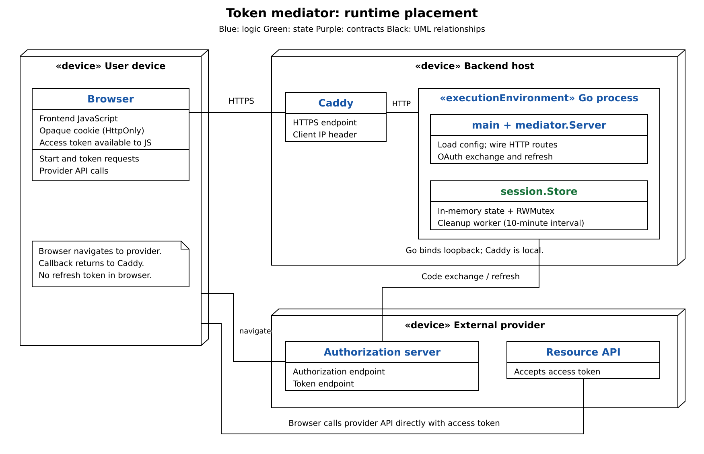
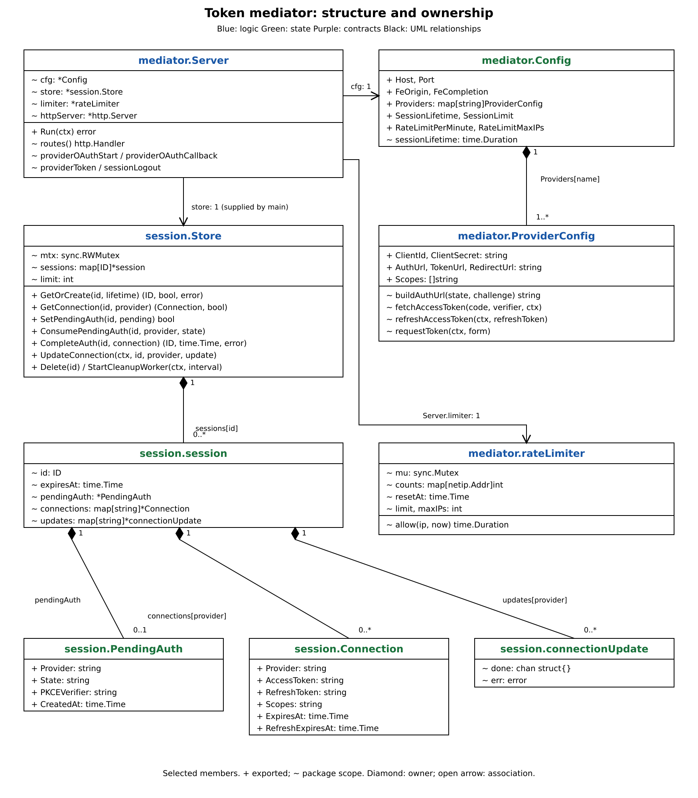
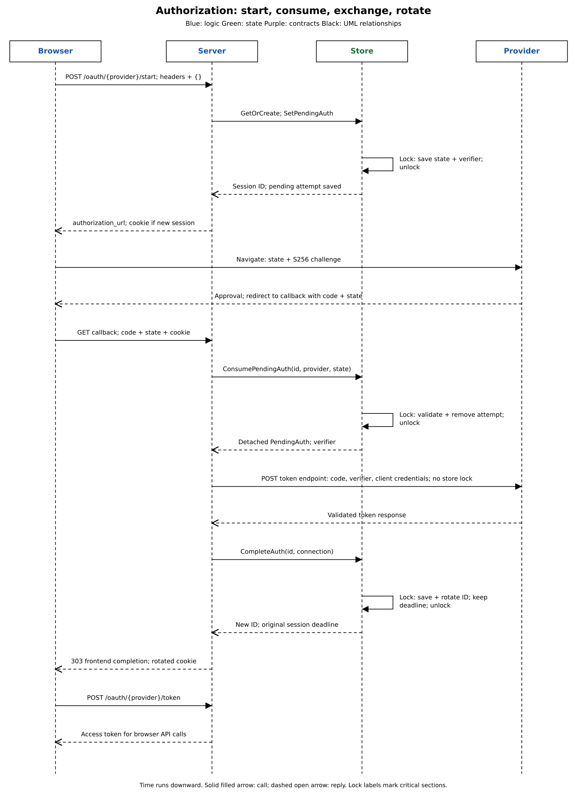
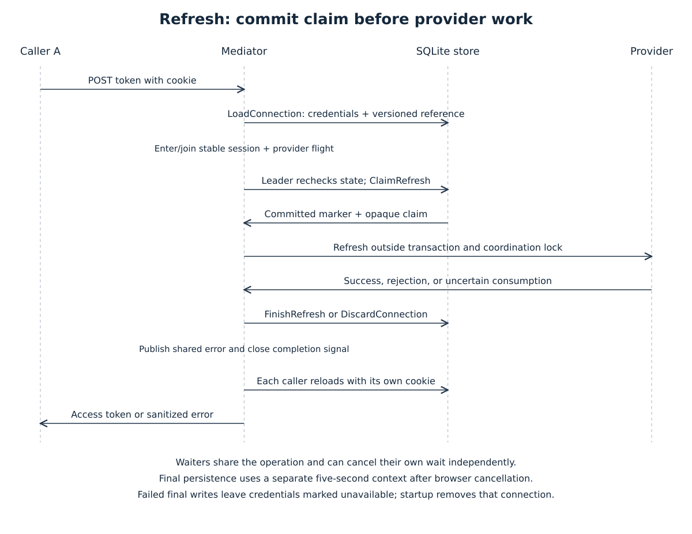

# Token mediator architecture

`main` wires configuration, one SQLite store, cleanup, and HTTP shutdown. `mediator.Server` owns browser protections and OAuth policy. `session.Store` owns SQL transactions, absolute expiry, and refresh coordination. The [breakdown](architecture-breakdown.md) follows these responsibilities in smaller steps; [Decisions to skip](<Decisions to skip.md>) records intentional limits.

## Runtime and setup



The frontend obtains access tokens from the mediator and calls provider APIs directly. Client secrets, refresh tokens, and proof-key verifiers stay on the backend. The mediator does not proxy resource requests.

Go listens on loopback behind Caddy on the same machine. Caddy must supply one client address in `X-Forwarded-For`; remote proxies and proxy chains are unsupported. Arrange HTTPS, matching registered callback URLs, and a frontend placement compatible with `SameSite=Lax`. Cross-origin requests need browser credentials as well as CORS permission. The repository supplies neither a frontend nor Caddy configuration.

Use the Go version in [go.mod](../go.mod). The SQLite driver is [modernc.org/sqlite](https://pkg.go.dev/modernc.org/sqlite), pinned to `v1.61.0`, and requires no C compiler.

```sh
make run
make run CONFIG_PATH=/path/to/config.json
```

`make run` sets `CONFIG_PATH`; direct `go run .` requires that environment variable. [config.example.json](../config.example.json) contains placeholder credentials and HTTP URLs, so it needs deployment configuration before browser authorization will work. Preserve the secure cookie settings.

| Configuration | Meaning |
| --- | --- |
| `database_path` | Required SQLite file path, relative to the working directory when not absolute. Example: `./data/sessions.db`. |
| `host`, `port` | Loopback listener address and port. |
| `session_lifetime`, `session_limit` | Absolute lifetime, from one second to 400 days, and maximum stored session count. |
| `rate_limit_per_minute`, `rate_limit_max_ips` | Shared OAuth allowance per IP and maximum tracked IPs. |
| `frontend_origin_url` | Exact permitted browser origin, including scheme and port. |
| `frontend_completion_url` | Redirect destination after successful authorization. |
| `providers` | Named credentials, authorization/token URLs, callback URLs, and requested scopes. |

Configuration has no defaults. Loading rejects unknown fields and validates required values, positive limits, and a loopback host. It does not comprehensively validate URL syntax or provider compatibility.

Startup creates new database directories with mode `0700` and sets the database to `0600`. One pooled connection uses enabled foreign keys, exclusive locking, rollback journaling (`DELETE`), `synchronous=EXTRA`, and a five-second busy timeout. These settings and exclusive ownership apply to every physical connection. The store acquires ownership before transactionally checking or initializing schema version 1 and deleting unfinished refresh connections. Unsupported versions, unrecognized schemas, another owner, or a storage failure prevent startup. [SQLite's exclusive locking mode](https://www.sqlite.org/pragma.html#pragma_locking_mode) also prevents external database inspection while the application owns the file.

Committed sessions survive restarts, including pending authorization, rotated credentials, and original deadlines. The first deployment of this store starts empty: memory sessions are not exported. Database files, journals, and backups contain sensitive credentials; file permissions do not provide application-level encryption. Example data files are ignored by Git.

Cleanup deletes expired sessions every ten minutes and reports failures without storage details. On shutdown, HTTP gets five seconds to drain before forced connection closure. The server then waits for handlers to finish their final persistence, stops and joins cleanup, and closes storage.

## Store boundaries



The store is a concrete SQLite implementation. There is no backend interface, memory mirror, or compatibility adapter. Detached values cross the package boundary; callers never own SQL transactions.

| Operation | Atomic responsibility |
| --- | --- |
| `BeginAuth` | Reuse or create an active session, replace its pending attempt, and return `BrowserSession` cookie metadata. |
| `ConsumeAuth` | Validate and delete pending authorization; return its verifier and an opaque `AuthHandle`. |
| `CompleteAuth` | Save the matching provider connection and rotate the cookie, preserving other providers and the absolute deadline. |
| `LoadConnection` | Join active session and provider state; return detached credentials and an opaque `ConnectionRef`. Marked credentials are unavailable. |
| `ClaimRefresh` | Conditionally mark the referenced revision as refreshing and return a `RefreshClaim`. |
| `FinishRefresh` | Conditionally save credentials and clear the claim's marker. |
| `DiscardConnection` | Delete only the referenced connection revision. A claim exposes its advanced reference for discard. |
| `Logout` | Delete a session and its dependent records; missing sessions succeed. |
| `CleanupExpired` | Delete expired sessions and their dependent records. |

Sessions and connections use never-reused internal keys. Cookie IDs are random and unique. One session has at most one pending attempt and one connection per provider; foreign keys cascade deletions. Timestamps are integer UTC microseconds; unknown token deadlines are SQL `NULL`. Missing state and storage failures have distinct errors.

The small refresh coordinator holds completion channels and shared errors, keyed by stable session identity and provider. It stores no credentials. Cookie rotation preserves that identity; reconnect creates a new connection row. SQL writes check row identity, revision, and session activity.

The [frozen in-memory package](../internal/legacy/inmemory/README.md) retains the original implementation and tests independently. The runtime does not import it.

## Browser HTTP boundary

| Route | Behavior |
| --- | --- |
| `GET /health` | Returns `{"status":"ok"}`. |
| `POST /oauth/{provider}/start` | Starts authorization and returns `authorization_url` and a session cookie. |
| `GET /oauth/{provider}/callback` | Consumes authorization, exchanges the code, rotates the cookie, and redirects with `303`. |
| `POST /oauth/{provider}/token` | Returns an access token, refreshing when needed. |
| `POST /session/logout` | Deletes local state, then clears its cookie and returns `204`. |
| `OPTIONS` on POST routes | Credentialed preflight from the configured origin. |

Browser POST requests require the exact origin, `X-OAuth-Bridge: 1`, `Content-Type: application/json`, and an empty object body. The 8 KiB body limit rejects fields, `null`, and trailing values. Preflights advertise POST with `Content-Type` and `X-OAuth-Bridge`.

OAuth start, callback, and token routes share a fixed one-minute allowance per IP. Logout and preflight are exempt. Rate rejection returns `429` with `Retry-After`; full session capacity returns `429 session_limit_reached`. Existing sessions are kept. Expired sessions reject access immediately but occupy capacity until cleanup; logout frees capacity immediately.

The `__Host-oauth_bridge` cookie contains an opaque random ID with `Secure`, `HttpOnly`, `SameSite=Lax`, `Path=/`, and no domain. Successful starts set the cookie directly from `BrowserSession`, including reuse with the original deadline. Callback completion rotates it. Responses use `Cache-Control: no-store`; callbacks also use `Referrer-Policy: no-referrer`.

Storage failures return sanitized `503 storage_unavailable` responses. Logout clears its cookie only after successful deletion. A missing session or connection still requires authorization; invalid callbacks still return `400` before contacting the provider.

## Authorization



1. The mediator generates OAuth state and the PKCE verifier and challenge before calling `BeginAuth`. The store owns creation time and the absolute session deadline.
2. `BeginAuth` atomically reuses or creates the session and replaces its pending authorization. The browser gets the provider URL and cookie; the verifier stays private.
3. `ConsumeAuth` validates cookie, provider, state, active session, and the ten-minute attempt lifetime. It removes a valid attempt atomically before any exchange. Denial or a missing code is rejected after consumption.
4. The mediator exchanges the code outside any SQL transaction or coordination lock, using the request context and client credentials in the form body.
5. `CompleteAuth` uses the opaque handle to save the matching provider connection and rotate the cookie atomically. Logout, expiry, provider mismatch, or an obsolete cookie reject completion. Other connections and the original deadline survive.
6. The callback sets the rotated cookie and redirects to the frontend completion URL. Tokens never appear in this redirect.

Consumed attempts cannot be replayed, even if the provider or final persistence fails. Overlapping attempts retain the ordering limit in [Decisions to skip](<Decisions to skip.md>).

## Token retrieval and refresh



| Connection state | Policy |
| --- | --- |
| Unknown access expiry, or more than two minutes remain | Return cached credentials without a database write. |
| At most two minutes remain and refresh token is usable | Refresh, including already expired access tokens. |
| No usable refresh token, access token still valid | Return the token until expiry. |
| No usable refresh token, access token expired | Discard the referenced connection and require authorization. |

The mediator loads SQL state and enters or joins the coordinator for refresh work. A leader rechecks current state and commits `ClaimRefresh` before contacting the provider. A stale reference triggers a fresh read. Provider calls hold no SQL transaction or coordination lock. Waiters can cancel independently; the leader's request context controls the shared provider call.

Successful refresh saves the new access token. Omitted refresh token and scope preserve their previous values; a replacement refresh token clears its old deadline unless a new lifetime is supplied. An omitted access lifetime produces unknown expiry.

| Provider outcome | Persistence and response |
| --- | --- |
| Success | `FinishRefresh` saves credentials and clears the marker. |
| `invalid_grant` or `bad_refresh_token` | Discard; return `401 reauthorization_required`. |
| Uncertain consumption, such as transport failure or malformed success | Discard; return sanitized `502 provider_error` or `504 provider_timeout`. |
| Known non-consuming rejection | Save original credentials to clear the marker; return the provider error. |
| Final persistence failure | Return `503`; the committed marker keeps the old credentials unavailable. |

Provider outcomes persist with a separate five-second context, even after browser cancellation. Startup removes connections with unfinished markers while retaining their sessions and other providers. An affected provider requires reconnection. Later requests cannot reuse a marked refresh token.

After shared completion, each caller reloads current credentials and validates its own cookie. Rotation does not invalidate another provider's refresh claim, but requests with the old cookie fail. Reconnect, logout, or expiry prevents stale writes. Delayed waiters read current credentials; shared errors are retained.

The browser receives only `access_token`, `token_type: "Bearer"`, optional remaining `expires_in`, and optional `scope`. Known access expiry is checked again before success. Logout removes local state without revoking tokens already issued at the provider.

## Validation and development

Provider calls time out after 15 seconds, reject redirects, and read at most 64 KiB. Validation checks HTTP success, JSON shape, bearer type when present, nonempty tokens, and positive, representable lifetimes. Initial exchange requires `token_type`; refresh accepts omission. HTTP header, read, and idle timeouts remain five, ten, and sixty seconds.

Use [OAuth tests](../internal/mediator/oauth_flow_test.go), [refresh tests](../internal/mediator/refresh_test.go), [storage failure tests](../internal/mediator/storage_test.go), and [transaction tests](../internal/session/store_test.go). Tests use temporary SQLite files and controlled `httptest` providers without real credentials.

```sh
go test ./...
go test -race ./...
```

Keep browser validation and provider policy in `mediator`, transactions and mutable state in `session`, and lifecycle wiring in `main`. Preserve trust-boundary validation, cancellation, body limits, guarded writes, and sanitized errors. Never log credentials, cookies, authorization codes, OAuth state, or tokens.
